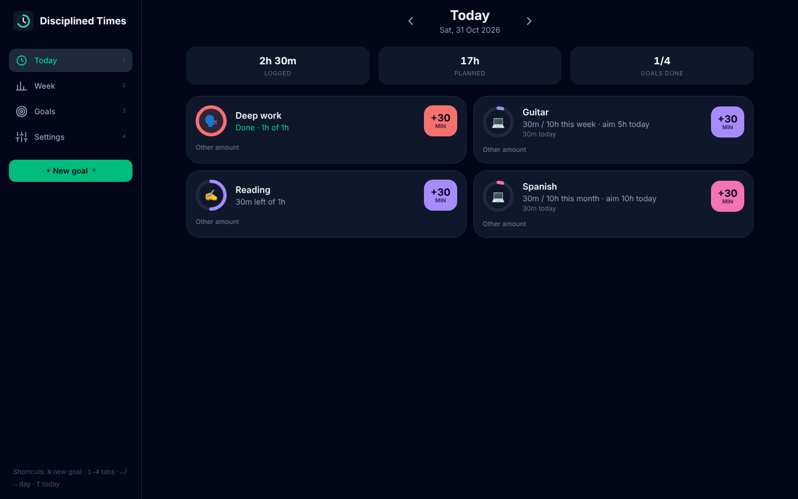
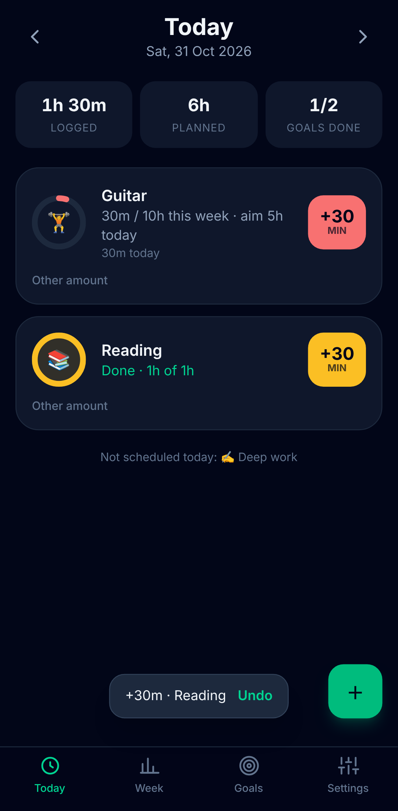
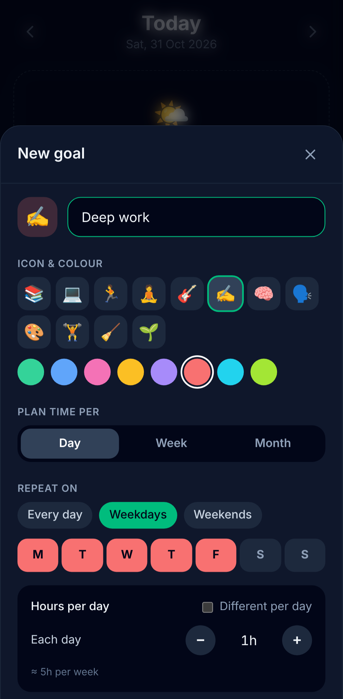
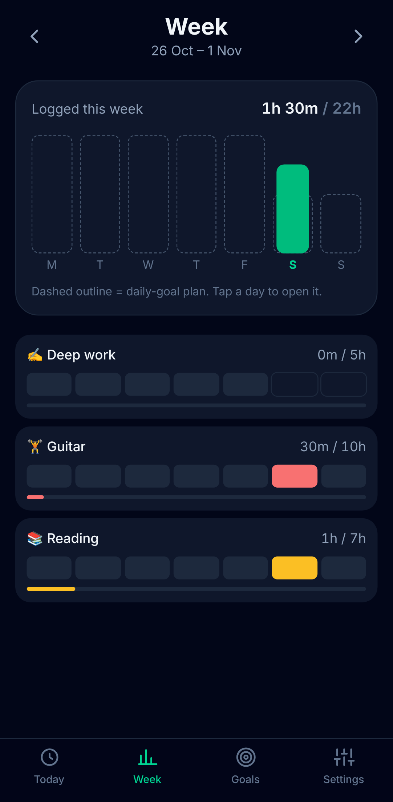
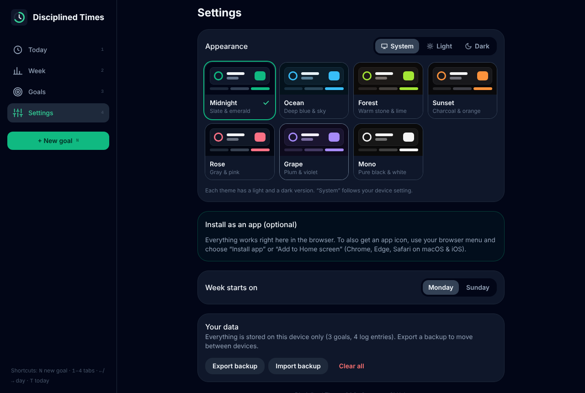
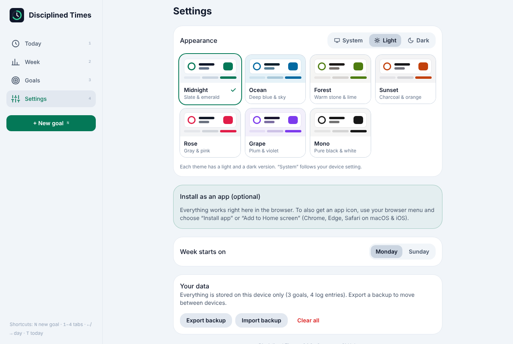

# Disciplined Times

A website for planning **hours per goal** and logging time in quick taps. It works in any desktop or mobile browser, and you can optionally install it as an app (PWA) on iOS, Android and desktop.

**Live:** https://nidplays.github.io/disciplined-times/

- Create goals and plan time **per day, per week, or per month**.
- Daily goals repeat on the weekdays you pick (Every day / Weekdays / Weekends / custom). They can also have **different hours per weekday**, e.g. 1h Mon–Thu and 3h on Saturday.
- Week and month goals show progress for the whole period plus a **suggested pace for today**.
- Tap the big **+30** button to log time. The step size is set per goal. Other amounts and corrections are one tap away, and every log can be undone.
- A **Week** view shows a bar chart of logged time against the plan, plus a per-goal heat strip. Swipe the chart left or right to change week.
- **Works as a normal website.** On desktop it has a sidebar, a multi-column layout and keyboard shortcuts (`N` new goal, `1`–`4` switch tabs, `←`/`→` change day, `T` today). Tabs live in the URL hash (`#week`, `#goals`), so browser back/forward and bookmarks work.
- **Themes:** Midnight, Ocean, Forest, Sunset, Rose, Grape and Mono. Each has a dark and a light version, and you can choose Light, Dark or follow the device (System) under Settings → Appearance.
- **Installs as an app** on iOS, Android and desktop, and works offline. All data stays on the device, with JSON export and import for backups.
- **Welcome tour:** first-time visitors get a short walkthrough of the app and all settings (appearance, week start, install, data), ending with "Create a goal" or "Open Settings" (scrolled to the install section). Replay it any time from Settings → Take the tour.
- **Changelog in the app:** Settings → View changelog shows what changed in each version (from `CHANGELOG.md`).



| Today | New goal | Week |
| --- | --- | --- |
|  |  |  |

| Themes (dark) | Themes (light) |
| --- | --- |
|  |  |

## Stack

- [Bun](https://bun.sh) for package management, scripts and tests (`bun test`)
- [Vite 8](https://vite.dev) + [React 19](https://react.dev) + TypeScript
- [Tailwind CSS 4](https://tailwindcss.com)
- [vite-plugin-pwa](https://vite-pwa-org.netlify.app) (Workbox) for the service worker, manifest and update prompt
- [Zustand](https://zustand.docs.pmnd.rs) (with `persist`) for local storage, and [date-fns](https://date-fns.org) for dates

Next.js is not used, on purpose. The app has no server, no SEO-critical pages and no auth. A static Vite SPA is simpler, loads faster offline and can be hosted anywhere: GitHub Pages, Netlify, Cloudflare Pages or Vercel.

## Develop

```sh
bun install
bun run dev        # http://localhost:5173 (service worker disabled in dev)
bun test           # unit tests for the scheduling logic
bun run build      # type-check + production build in dist/
bun run preview    # serve dist/ to test install/offline behaviour
bun run icons      # regenerate PNG icons from public/logo.svg
bun run build:pages && bun run preview:pages   # test the GitHub Pages build at /disciplined-times/
```

## Deploy

### GitHub Pages (current)

`.github/workflows/deploy.yml` runs tests and a build on every push and pull request. It deploys only on pushes to `main` of `NidPlays/disciplined-times`:

- **Pull requests, including from forks, never deploy.** They don't touch Pages at all and run with read-only permissions.
- **Forks never deploy,** even from their own `main`.
- **Only the deploy job gets Pages permissions** (`pages: write`, `id-token: write`).
- **Production deploys aren't cancelled by later pushes.** Superseded PR runs are.

One-time setup: **Settings → Pages → Build and deployment → Source: GitHub Actions**.

The build reads `BASE_PATH` from `actions/configure-pages`, so the site works at `/<repo>/` and also with a custom domain (base `/`). Navigation is hash-based, so no `404.html` SPA workaround is needed.

### Cloudflare (later)

Run `bun run build` (base `/`) and serve `dist/` as static assets, using Workers static assets or Pages. No other changes are needed.

## Home-screen shortcuts & deep links

| URL | What it does |
| --- | --- |
| `?action=quick-log&minutes=30` | Opens a sheet where one tap adds 30 min to a goal |
| `?log=<goalId>&minutes=30` | Adds 30 min to that goal immediately (with an Undo toast) |
| `?action=new-goal` | Opens the new-goal form |
| `#week`, `#goals`, `#settings` | Opens a tab (also `?tab=week`) |

The manifest declares **app shortcuts** for "+30 min", "Today" and "New goal". On Android (Chrome) and desktop Chrome/Edge, long-press or right-click the installed icon to use them. To get a per-goal `?log=` link, use the 🔗 button in the Goals tab.

### Platform notes

- **Desktop browsers**: everything works without installing. Chrome and Edge can also install it as a windowed app, with shortcuts on right-click.
- **Android**: full install prompt and manifest shortcuts.
- **iOS / iPadOS**: install from Safari via Share → *Add to Home Screen*. Safari does not support manifest shortcuts.
- **Widgets**: PWAs can't add home-screen widgets on iOS or Android today. Only Windows (Edge) implements the PWA widgets spec. The closest cross-platform options are the shortcuts and deep links above.

## Data model

```ts
Goal     { id, name, emoji, color, period: 'day'|'week'|'month',
           dayTargets: { [weekday 0-6]: minutes },  // daily goals
           periodTarget: minutes,                    // week / month goals
           step: minutes, archived }
LogEntry { id, goalId, minutes, date: 'yyyy-MM-dd', at }
```

Scheduling and progress logic lives in `src/lib/schedule.ts` and is covered by `src/lib/schedule.test.ts`.

## Theming

Components use semantic Tailwind tokens instead of fixed colours:

- `n-950` … `n-100`: neutral scale, from page background to main text
- `accent`, `accent-hover`, `accent-fg`, `on-accent`: accent colour and its variants
- `success`, `danger`: status colours

`src/lib/themes.ts` maps each theme and mode onto those CSS variables. In light mode the neutral scale is inverted, with white cards on a tinted page. To add a theme, add an entry to `THEMES`.

## Accessibility

Text is designed to meet **WCAG 2.2 AA** in every theme, in both light and dark mode:

- **Contrast is enforced.** When building a theme, `themeVars()` nudges each text colour towards the main text colour until it reaches its target against every surface it is drawn on (page, card, chip):
  - primary and body text: ≥ 7:1 (AAA)
  - secondary and caption text, accent text, success/danger: ≥ 4.5:1 (AA)
  - outlines, rings and progress graphics: ≥ 3:1
- **Tested.** `src/lib/themes.test.ts` checks every text/surface pair for every theme and mode (164 checks), plus labels on goal colours and on accent buttons.
- **Readable sizes.** Nothing is smaller than 12px, and secondary text is never faded with opacity.
- **Keyboard.** There's a visible focus ring on every control, keyboard shortcuts on desktop, and Esc closes dialogs.
- **Motion.** Animations are turned off when the OS "reduce motion" setting is on.

## License

MIT
